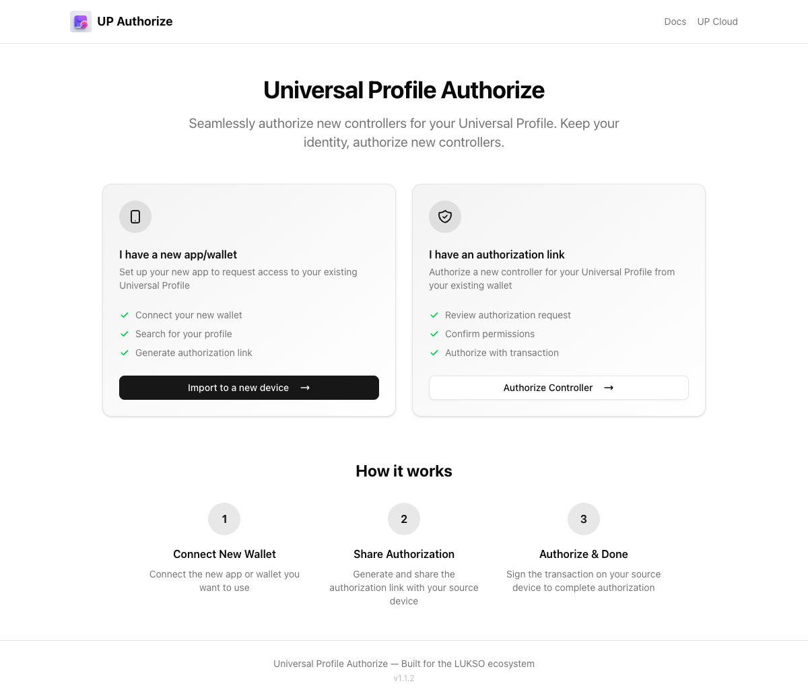

# Authorize Controller

The [Authorize Controller](https://authorize.universalprofile.cloud/) tool lets you manage controller keys on your Universal Profile. Use it to grant permissions to new controllers, migrate your profile to a new device, or import your profile into a new browser extension.

🔗 **[authorize.universalprofile.cloud](https://authorize.universalprofile.cloud/)**

:::info Keep Your Initial Controller Key Safe

The controller key your Universal Profile was originally created with is important — it's required if you ever want to deploy your profile across multiple networks. This key lives in the device where you first created your profile (the mobile app or the browser extension).

**Back it up** using the backup feature in your app:

- **UP Browser Extension** — use the built-in backup feature to export your key
- **UP! App** — in Settings → Backup & Restore, use **Create file backup** to save a backup file that you keep. The app also keeps an automatic backup through your phone's backup service (iCloud Keychain on iOS, Google Block Store on Android). Whether that copy reaches your cloud account depends on your phone's backup settings, which the app can't see.

:::

## Use Cases

### Migrate to a New Device

If you're setting up a new computer or phone and want to access your existing Universal Profile:

1. Install the [Universal Profile Browser Extension](https://chromewebstore.google.com/detail/universal-profiles/abpickdkkbnbcoepogfhkhennhfhehfn) on the new device
2. Open the Authorize tool on your **old device** (where you still have access)
3. Connect your Universal Profile
4. Enter the new extension's controller address and select the permissions you want to grant
5. Confirm the transaction — your profile is now accessible from both devices

:::tip

When you stop using the old device, [remove its controller](#remove-a-controller). Uninstalling the app or extension there doesn't revoke its permissions.

:::

### Import into Browser Extension

When you have a Universal Profile that was created outside the browser extension (e.g., via a dApp or programmatically), you can import it:

1. Open the Authorize tool and connect via **WalletConnect** or the **UP Browser Extension**
2. Enter the controller address from your browser extension
3. Grant the necessary permissions
4. Your profile will now appear in the extension

### Manually Authorize a Controller

For advanced users who need to grant specific permissions to any address:

1. Connect your Universal Profile
2. Enter the controller address
3. Select individual permissions (e.g., `CALL`, `SETDATA`, `TRANSFERVALUE`)
4. Optionally configure **Allowed Calls** to restrict which contracts the controller can interact with
5. Optionally configure **Allowed Data Keys** to restrict which ERC725Y data keys the controller can modify
6. Confirm the transaction

## Features

- **Connect via UP Browser Extension or WalletConnect** — use whichever wallet has access to your profile
- **Permission selector** — pick exactly which [LSP6 permissions](../../standards/access-control/lsp6-key-manager.md) to grant
- **Allowed Calls** — restrict a controller to specific contracts, interfaces, or functions
- **Allowed Data Keys** — restrict which data keys a controller can read or write
- **Smart array management** — reuses empty slots in the controller array to save gas

## How It Works

The tool writes data to your Universal Profile's [ERC725Y](../../standards/erc725.md) storage using `setDataBatch` on the [LSP0 ERC725Account](../../standards/accounts/lsp0-erc725account.md). It sets:

- The controller's address in the `AddressPermissions[]` array
- The controller's permissions under `AddressPermissions:Permissions:<address>`
- Optionally, `AddressPermissions:AllowedCalls:<address>` and `AddressPermissions:AllowedERC725YDataKeys:<address>`

All of this is managed by the profile's [LSP6 Key Manager](../../standards/access-control/lsp6-key-manager.md), which enforces the permissions on every transaction.

## Remove a Controller

Revoking a controller and removing a Universal Profile from an app are different actions:

- **Revoking a controller** is an on-chain transaction. It clears the controller's `AddressPermissions:Permissions:<address>` and removes its address from `AddressPermissions[]`, so the [LSP6 Key Manager](../../standards/access-control/lsp6-key-manager.md) rejects anything it signs afterwards. The controller that sends this transaction needs the [`EDITPERMISSIONS`](../../standards/access-control/lsp6-key-manager.md#permissions) permission.
- **Removing a Universal Profile from an app**, uninstalling the app or browser extension, or losing the device only changes what that app shows. The controller keeps its permissions on-chain until it is revoked.

:::caution

If a device that holds one of your controllers is lost, revoke that controller from another controller that has `EDITPERMISSIONS`. Nothing done to the app on the lost device removes its permissions.

:::

### In the UP! App

- **Another controller**: with the Universal Profile selected, open Settings → Controllers, select the controller and tap **Remove controller**. The UP! App's own controller for that Universal Profile needs `EDITPERMISSIONS`. The removal applies to the network that is selected in the app. The app doesn't offer this for its own controller.
- **The app's own controller**: open Settings → Profiles, select the Universal Profile and tap **Remove profile**. For a Universal Profile the app controls, this first sends a transaction that revokes the app's controller on the selected network, which also needs `EDITPERMISSIONS`, and then removes the Universal Profile from the app. The private key stays on the device.
- **A Universal Profile the app only views, or one still waiting for permissions**: **Remove from this device** removes it from the app only. No transaction is sent, and on-chain permissions stay as they are.

### Browser Extension Controllers

The UP Browser Extension's controller is revoked like any other controller: from a controller that has `EDITPERMISSIONS`, for example in the UP! App under Settings → Controllers. Uninstalling the extension or clearing the browser doesn't revoke it.

## Controllers and Networks

Each network keeps its own permissions for a Universal Profile:

- A Universal Profile has the same address on every network where that same Universal Profile was deployed. It doesn't exist on a network where it was never deployed, and creating a Universal Profile there makes a new one with a different address.
- Adding or removing a controller on LUKSO Mainnet doesn't change LUKSO Testnet, and the other way around. Repeat the change on each network where you use the Universal Profile.
- Each app install has its own controllers. Importing a Universal Profile into the UP! App on a network where none of the app's controllers has permissions yet creates a new private key, which becomes a controller once it is granted permissions there. The same Universal Profile can therefore have different controllers on different networks.
- The UP! App's automatic backup stores each Universal Profile with the app's controller for it, but not the network. Restoring it brings each Universal Profile back on LUKSO Mainnet when that controller has permissions there, and otherwise on LUKSO Testnet.
